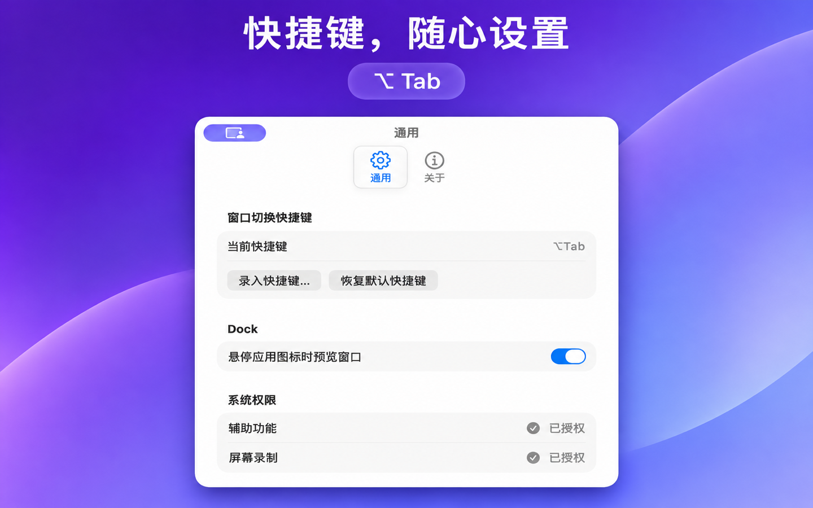
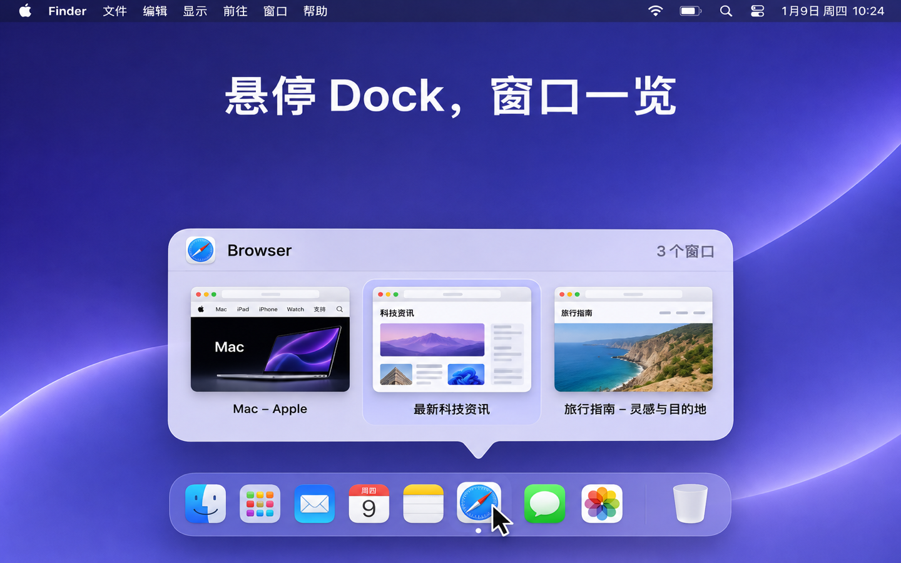
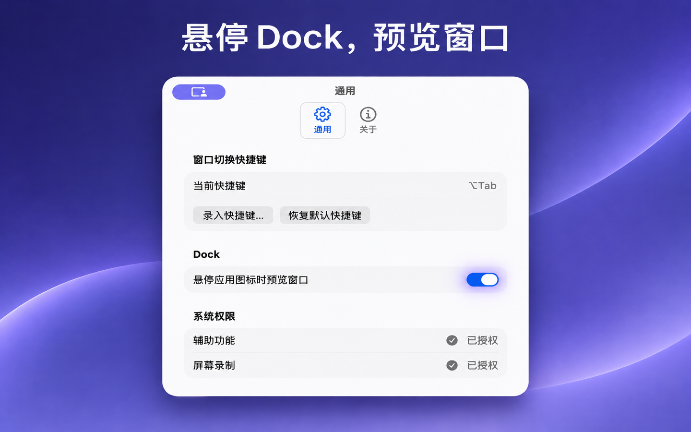
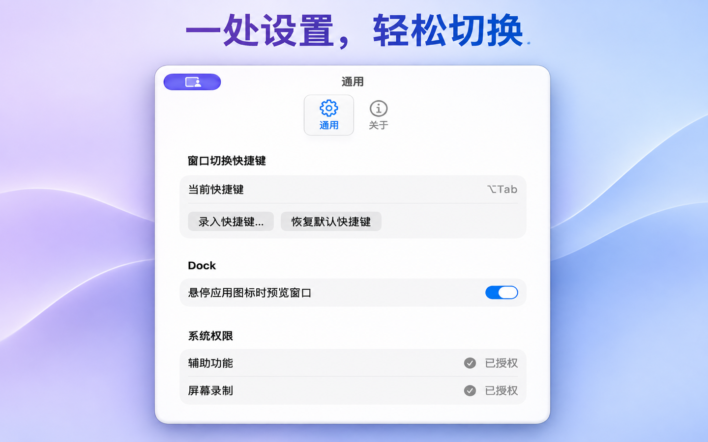

# LutraSwitch

LutraSwitch 是 macOS 26 及以上版本的菜单栏窗口切换器。默认使用 `⌥Tab`（Alt + Tab），按窗口的最近使用顺序选择，支持在同一个应用的多个窗口之间切换。

## 应用截图

<p>
  <a href="docs/screenshots/shortcut-asc.png"></a>
  <a href="docs/screenshots/dock-preview-asc.png"></a>
</p>

<p>
  <a href="docs/screenshots/dock-asc.png"></a>
  <a href="docs/screenshots/control-asc.png"></a>
</p>

## 运行

1. 用 Xcode 26 或更新版本打开 `LutraSwitch.xcodeproj`，选择 **LutraSwitch** scheme 和 **My Mac**，然后按 `⌘R`。
2. 从菜单栏打开 LutraSwitch 的「设置」，授权「辅助功能」。如果仍无法启用监听，并且设置显示「输入监控」，按提示授权后重新打开应用。
3. 需要窗口缩略图时，在设置中授权「屏幕录制」。其他情况下可用图标和标题识别窗口，最小化窗口也会在没有可用缩略图时显示图标。

项目默认使用本地临时签名。重新构建后，如果 macOS 不再识别之前的授权，可在系统设置中移除旧条目并重新添加当前构建；持续开发也可以配置自己的开发签名。

## 使用

- 按住 `⌥` 并轻按 `Tab` 打开预览。默认选中上一个获得焦点的窗口，松开 `⌥` 即切换。
- 继续按住修饰键，再按触发键或 `→` 选择下一个窗口，按 `←` 选择上一个。按 `Esc` 取消。
- 预览打开时，鼠标划过卡片可选中窗口，点击立即切换。鼠标滚轮可来回轮选。
- 两种预览都先显示 5 张窗口缩略图，其余窗口使用带标题的应用图标，在下方分行排列。图标区放不下时可以翻页。
- 在设置中可录入含 `⌘`、`⌥` 或 `⌃` 的组合键，也可以加 `⇧`。松开任一必需修饰键即确认。
- 在「设置 → 通用」录入 `⌘Tab` 或 `⌘⇧Tab`，也可以点「使用 ⌘Tab」，即可接管 macOS 的应用切换快捷键。按 `⌘Tab` 正向轮选窗口，按 `⌘⇧Tab` 反向轮选，松开 `⌘` 确认。改回其他快捷键、退出应用或快捷键监听停用时，这两个组合键由 macOS 处理。
- 在「设置 → 通用 → 启动」开启「添加到启动项」，可在登录 macOS 时自动打开 LutraSwitch。
- 窗口范围为各显示器当前显示的 Space，包含被遮挡和最小化的普通窗口。选择最小化窗口会恢复它。已关闭的窗口、隐藏的应用和其他 Space 的窗口会被过滤。
- 鼠标停在 Dock 中正在运行的应用图标上，即可预览它在当前 Space 的窗口。点击缩略图或图标即可切换。可在「设置 → Dock」关闭悬停预览。

## 测试

```sh
xcodebuild -project LutraSwitch.xcodeproj -scheme LutraSwitch -destination 'platform=macOS' test
```

真机检查可在 macOS 26 和更新版本上进行。

1. 在微信和 Chrome 之间切换，按住 `⌥` 并轻按 `Tab`，确认微信默认高亮、松开切回。再试一次快速按下并松开。
2. 为 Chrome 打开两个同名窗口，交替聚焦。验证 LutraSwitch 选中并聚焦指定窗口。依次测试轮选、取消和最小化窗口恢复。
3. 关闭一个窗口，再关闭某个应用的最后一个窗口，确认对应卡片消失。将一个普通窗口和一个最小化窗口放到其他 Space，确认都不会出现在当前桌面列表中。连接外接显示器后重复检查。
4. 录入一个自定义快捷键，退出并重新启动，确认新快捷键仍然生效且系统 `⌘Tab` 照常工作。关闭屏幕录制权限，确认用图标和标题仍可切换。
5. 在设置中点「录入快捷键…」并按 `⌘Tab`。确认设置保存且两个切换器都未弹出。再次按 `⌘Tab` 或 `⌘⇧Tab`，确认只打开 LutraSwitch，并可在按住 `⌘` 时切换轮选方向。退出应用后确认原生应用切换器恢复，重启 LutraSwitch 后确认接管设置仍生效。点「恢复默认快捷键」后确认 `⌥Tab` 打开 LutraSwitch，`⌘Tab` 打开系统切换器。

## 系统兼容性

LutraSwitch 通过只读系统接口关联 Accessibility 窗口与 WindowServer ID，并查询其 Space 归属。Space 接口不可用时，仅列出系统报告在屏的可切换窗口。窗口 ID 接口不可用时会停用快捷键接管。系统升级后应重新验证这些路径。缩略图通过 ScreenCaptureKit 按需获取，只保存在内存中。

## 常驻运行与资源预算

- 两种预览共享截图通道，同一时间只执行一组截图；等待中的请求只保留最新的一组。取消后的结果不会重新填入已清空的缓存。
- 截图缓存按位图字节数限制为 8 MiB、最多 16 张，按最近访问淘汰。未使用 120 秒的缓存由维护计时器清除；应用退出、睡眠和内存压力也会触发对应清理。最小化窗口的旧截图过期后会显示应用图标。
- 上述预算仅指缓存持有的位图，不等于进程总内存；可见预览、SwiftUI/AppKit、ScreenCaptureKit 和 WindowServer 的资源另计。
- Dock 鼠标事件合并为最多约每秒 18 次采样；鼠标静止、悬停判定完成后停止该计时器。空闲维护每 5 秒运行一次，显示预览时每秒刷新窗口列表。
- 后台 AX 查询使用串行队列和每个工作项的自动释放池。控制器停止或销毁时会移除计时器、事件监听和通知监听，并安全拆除 AX 观察者。

长时间回归建议使用 Release 构建：连续运行数小时，交替测试快捷键与 Dock 预览、快速取消、窗口大量创建/关闭、最小化、多显示器、Space 切换和睡眠唤醒；对比多轮操作后空闲 2–3 分钟的物理内存，确认没有持续单调增长。可用 Instruments 的 Allocations/Leaks 定位增长来源，不能仅凭一次 `leaks` 无泄漏结果判断长期稳定。
